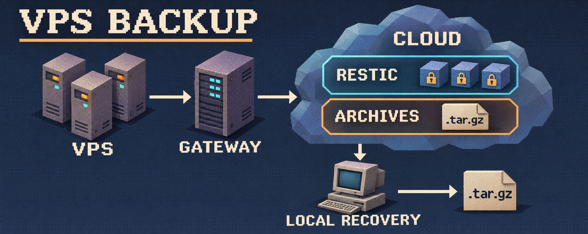

# VPS Backup

Back up Docker apps from several VPS to cloud storage. Cloud credentials stay
on one backup server. Choose a storage format for each VPS:

| Mode | Stored in the cloud | When files change |
| --- | --- | --- |
| `restic` | Encrypted snapshots | Upload changed chunks |
| `archive` | Ordinary `.tar.gz` files | Upload a new archive for the changed app |

Both modes handle SQLite copies, optional container stops, free-space checks,
and temporary-file cleanup. Use n8n, a systemd timer, or manual commands.

```bash
sudo vps-backup snapshots
sudo vps-backup export --app melodix
```

The export is a normal archive you can download and unpack. On your own
computer, launch `recover.cmd` (Windows) or `sh recover.sh` (Linux) to choose a
backup and save an archive. Both storage modes use the same helper.

- [Set up a VPS and choose a schedule](docs/setup.md)
- [Recover on Windows or Linux](docs/local-recovery.md)
- [Import the n8n workflow](docs/n8n.md)
- [Configuration and troubleshooting](docs/running.md)
- [Restore and server-loss recovery](docs/recovery.md)
- [How it works](docs/architecture.md) / [Development](docs/conventions.md)

Clients run on Debian/Ubuntu. Local recovery supports Windows and Linux with
Python 3.10+. Archive mode stores readable files in the cloud; restic encrypts
them. Automatic retention is not implemented, so old backups remain stored.
